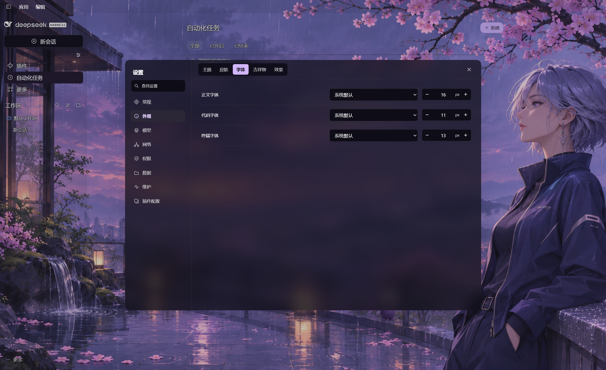

# Beelli X UI

**Beelli X 界面增强**是为 Windows 上的 DeepSeek Harness NEXT 做的桌面界面插件。你可以按原工作区找回归档聊天、给每只桌宠上传自己的动作，也可以统一调整侧栏、对话区和右侧面板的外观。

**版本 0.1.1 · MIT · 作者 Beellix-dev**

## 功能亮点

- **按工作区管理归档聊天**。在「设置 → 已归档的聊天」按原工作区浏览和搜索。可以取消归档，也可以确认后单条或批量删除本地聊天记录。列表当场更新，客户端继续运行。
- **给每只桌宠配置自己的动作**。上传动图作为宠物的默认动作，可以保留多只宠物并切换当前使用的那只。其他动作按宠物分别添加，右键点桌宠即可播放，播完回到默认动作。
- **让壁纸和界面融在一起**。用内置插画或导入图片、MP4，分别调整侧栏和右侧面板的磨砂与透明度。对话区用一块连续的半透明阅读区域，便于读长消息。
- **在插件页直接切换市场**。已安装插件按官方和第三方分开，市场可在同一页切换，也能直接添加自定义目录。侧栏控件可按需显隐和排序。

**English** · A desktop UI extension for DeepSeek Harness NEXT on Windows. Browse and restore archived chats by workspace, confirm local deletion individually or in batches, give each desktop pet its own uploaded animations, and switch plugin catalogs on a single page. Wallpaper and frosted panels can be customized together.




## 安装

- **预构建包**。从 [GitHub Release](https://github.com/Beellix-dev/beellix-dsh-ui/releases/tag/v0.1.1) 下载 `beellix-dsh-ui-0.1.1.tgz`，在 DSH 的「插件 → 添加插件」中导入。
- **npm**。在 DSH 的「添加插件」中输入 `@beellix-ai/dsh-web-gui`。如果镜像源提示找不到包，在「安装源」中改用 npm 官方注册表 `https://registry.npmjs.org/`，或导入上面的预构建包。

宿主提示重启时，先保存当前工作再正常重启。建议同一时间只启用一个接管设置页或侧栏的界面插件。

## 兼容与边界

实际桌面验收基线为 **Next 2.0.21-next、Harness / frontend 0.2.1-rc.4、Windows**。清单声明 `engines.dsh >=0.2.1-rc.4 <0.3.0`，该范围不代表其中每个版本或其他操作系统均完成实机验收。

本包通过原生 Bundle 替换设置和侧栏入口，沿公开服务配置宿主功能；安装卸载由 DSH 管理。模型目录来自实际服务接口，连接是否可用仍取决于厂商地址、凭据和模型权限；模型请求及费用按所选厂商处理。

归档删除已在 Windows DSH NEXT 的默认 `desktop` Profile 与标准本地会话存储验证。删除操作清理选中对话的日志、归档标记、工作区关联和对应缓存。其他组件持有写入锁时保留该对话并提示原因。工作区目录内的项目文件继续保留。

皮肤使用共享背景与独立面板，支持静态图片、MP4、CSS 磨砂。三款内置插画原生尺寸为 1672×941。没有 Wallpaper Engine Scene/Web 渲染引擎。桌宠支持动态 WebP（100 MB 以内）和 GIF（20 MB 以内）。默认动作循环展示，其他动作播放一轮后回到默认动作。壁纸文字采样不能保证任意复杂图像上的所有文字均清晰。

最多显示三个已注册环境模块；目前内置真实环境模块只有工作区。环境贡献接口仅转交呈现和新会话操作，不提供环境后端或数据隔离。

## 数据与停用

配置独立使用 `dsh-web-gui` 命名空间；导入媒体保存在所属 DSH 环境的 `DSHWebGui/ui/media`。不会创建 Beellix 企业目录，不自动迁移其他插件资料。

停用／卸载后由宿主恢复原生入口，用户媒体与设置保留；需要删除媒体时请在卸载前从素材库移除。DSH 会话、工作区文件、模型凭据由宿主管理，不属于本插件卸载范围。出现加载问题时可从宿主恢复页面停用本包后重启。

## 从源码构建

独立源码快照需要 Node.js 22+，推荐 Node.js 24；Windows 使用 PowerShell 7。

```sh
npm ci --ignore-scripts
npm run build
npx playwright install chromium
npm test
npm pack --ignore-scripts
```

测试中的浏览器使用固定版本与防账户锁定参数。源码构建不读取日常 DSH 配置、不安装或重启客户端。`lib` 是构建输出；安装预构建包不需要本机编译。

问题报告请提供版本、复现步骤和已脱敏日志。源码与素材的权属见 [LICENSE](LICENSE) 和 [第三方声明](THIRD_PARTY_NOTICES.md)。贡献说明见 [CONTRIBUTING.md](https://github.com/Beellix-dev/beellix-dsh-ui/blob/main/CONTRIBUTING.md)，变更见 [CHANGELOG.md](https://github.com/Beellix-dev/beellix-dsh-ui/blob/main/CHANGELOG.md)。
