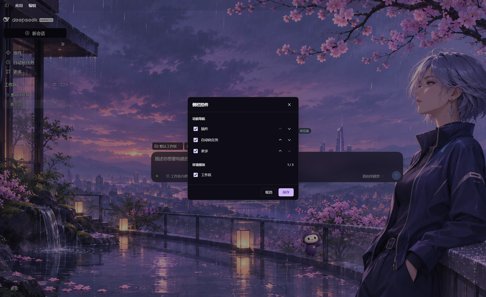
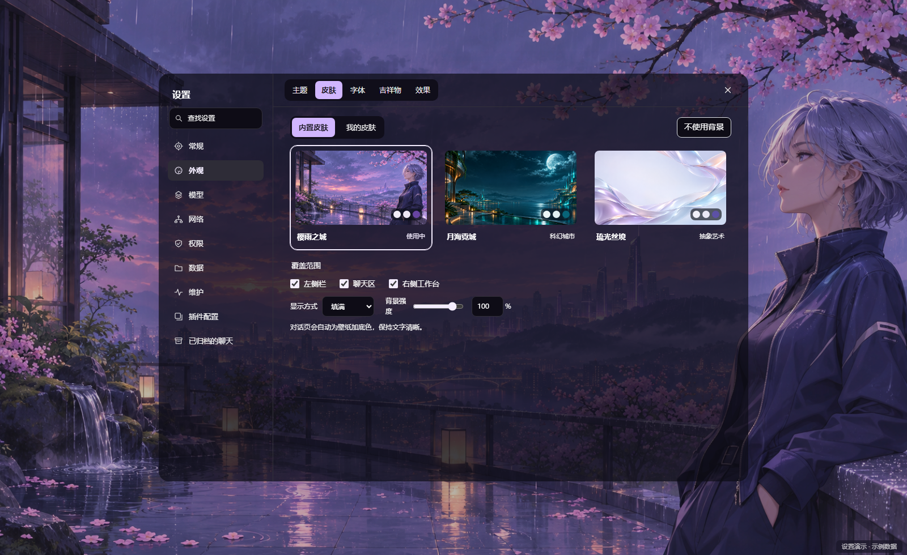
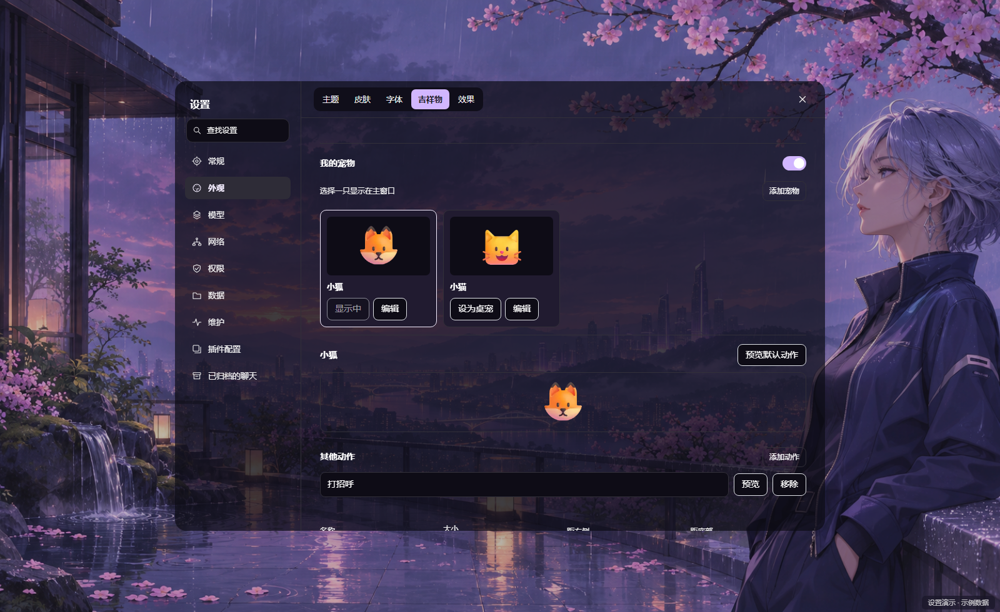
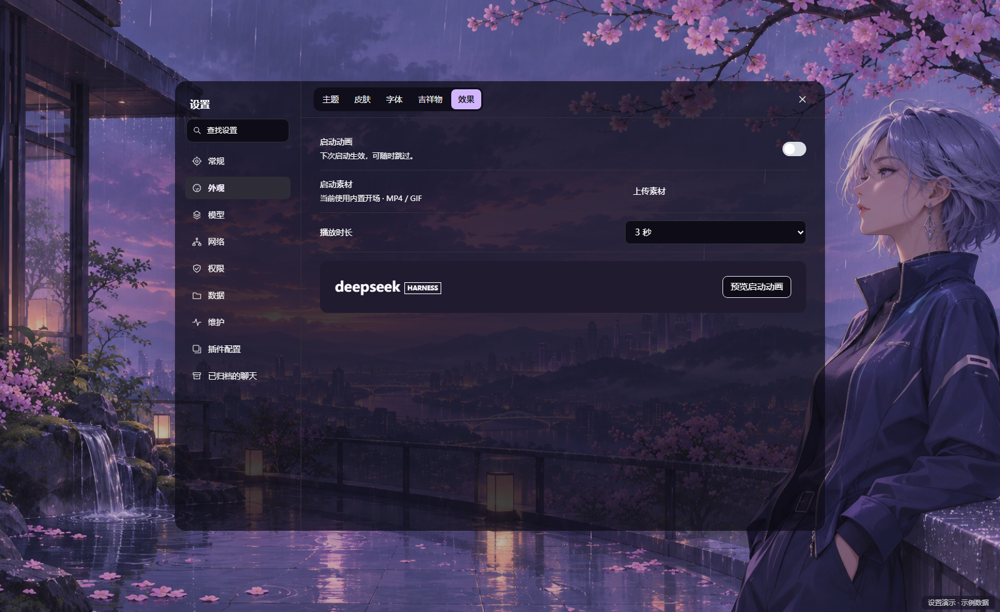
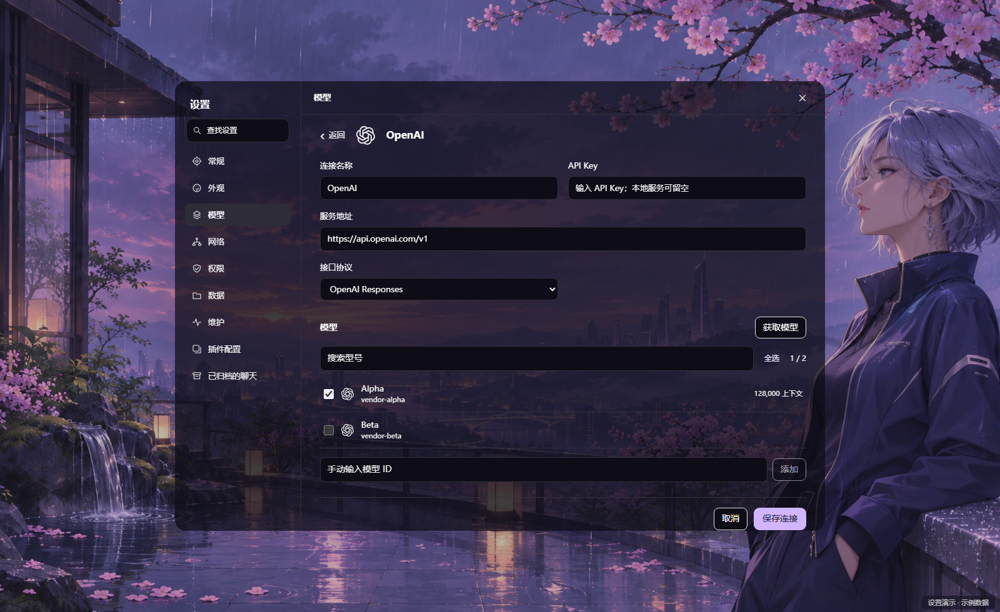
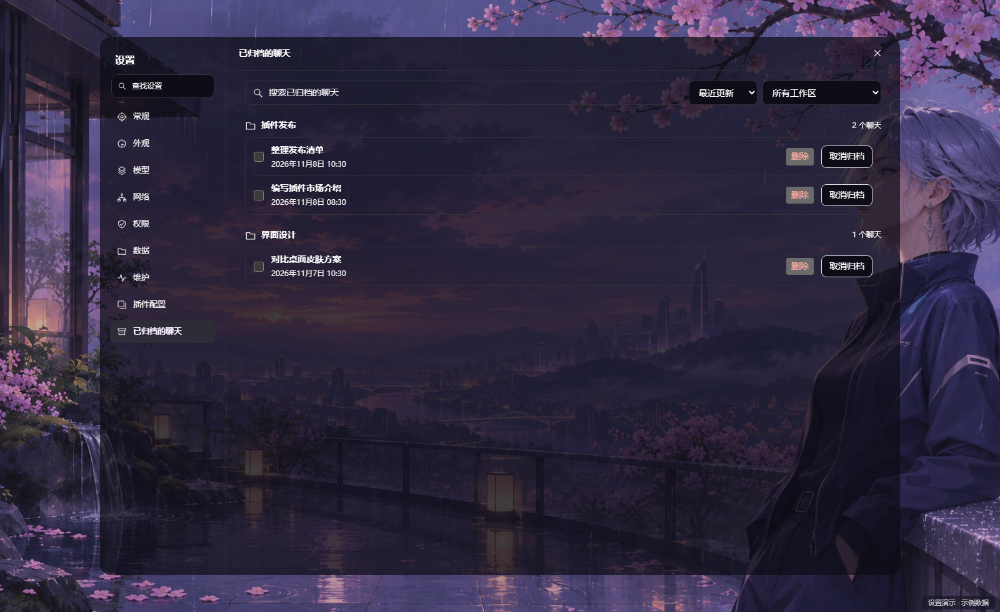

# Beelli X UI

**Beelli X UI** 为 Windows 上的 DeepSeek Harness NEXT 提供统一的设置和桌面外观。换一套皮肤、养自己的桌宠、定制启动动画，或从模型页接入常用服务。

**版本 0.1.1 · MIT · 作者 Beellix-dev**



## 设置怎么组织

左栏负责选分类，顶部标签负责切换同类设置。可以用「查找设置」按分类、子页或设置项名称定位。窄窗口用下拉选择分类。

| 左栏入口 | 右侧内容 |
| --- | --- |
| 常规 | 常规、对话与输入、快捷键、通知 |
| 外观 | 主题、皮肤、字体、吉祥物、效果 |
| 模型 | 查看已添加的连接、选厂商或添加自定义连接。提供模型配置的插件会显示在「插件模型」标签 |
| 网络、权限、数据 | 分别进入对应的 DSH 设置 |
| 维护 | 诊断与维护、运行环境、关于与更新 |
| 插件配置 | 查看已加载的插件配置，插件提供的设置入口会在这里显示 |
| 已归档的聊天 | 按原工作区查看归档，支持搜索、恢复和删除 |

DSH 的模型、网络和权限等设置继续通过宿主接口读写。皮肤、桌宠和启动动画使用 Beelli X UI 自己的配置。

## 功能展示

### 皮肤 · 设置 → 外观 → 皮肤

直接预览内置插画，或把图片、MP4 导入「我的皮肤」。可选择壁纸覆盖左侧栏、聊天区和右侧工作台中的哪些区域，在「主题」调整配色、磨砂与透明度，再把搭配保存为自己的皮肤方案。



### 宠物 · 设置 → 外观 → 吉祥物

上传一段动态 WebP 或 GIF 就能添加宠物，这段动图会作为它的默认动作。可以保留多只、选一只显示，给每只宠物添加各自的动作。右键点桌宠即可选动作，播放完会回到默认动作。



### 效果 · 设置 → 外观 → 效果

可开启内置启动动画，也可以上传 MP4 或 GIF。选择 1、2、3 或 5 秒，在设置里先预览，启用后下次启动播放，也可以在播放时跳过。



### 模型 · 设置 → 模型

可选 DeepSeek、OpenAI、Anthropic 等厂商预设，也能填写自定义服务地址和接口协议。配置后可从服务获取型号并勾选需要的模型，也可以手动添加模型 ID。



### 归档聊天和插件市场

- **归档聊天**可按原工作区浏览和搜索，取消归档会恢复到原工作区。确认删除后清理本地聊天记录，支持单条和批量删除，列表即时更新。
- **插件市场**可在同一页切换和添加。已安装的官方插件与第三方插件分开查看，侧栏控件也能按需显隐和排序。



五张设置演示统一使用深色主题和「樱雨之城」壁纸。桌宠、模型和归档内容均为示例。

**English** · Beelli X UI brings searchable settings to DSH NEXT on Windows. Appearance groups themes, skins, fonts, pets, and effects, while Models has its own page. Use images or MP4 wallpaper, adjust frosted panels, and save skin presets. Switch between pets and upload default and extra animations for each one. Preview, time, or skip MP4 and GIF startup animations. Add model connections from provider presets or a custom endpoint, fetch and select models, or enter model IDs manually. You can also restore or bulk-delete archived chats by workspace and switch or add plugin catalogs on the same page.

## 安装

- **预构建包**。从 [GitHub Release](https://github.com/Beellix-dev/beellix-dsh-ui/releases/tag/v0.1.1) 下载 `beellix-dsh-ui-0.1.1.tgz`，在 DSH 的「插件 → 添加插件」中导入。
- **npm**。在 DSH 的「添加插件」中输入 `@beellix-ai/dsh-web-gui`。如果镜像源提示找不到包，在「安装源」中改用 npm 官方注册表 `https://registry.npmjs.org/`，或导入上面的预构建包。

宿主提示重启时，先保存当前工作再正常重启。建议同一时间只启用一个接管设置页或侧栏的界面插件。

## 兼容与边界

实际桌面验收基线为 **Next 2.0.21-next、Harness / frontend 0.2.1-rc.4、Windows**。清单声明 `engines.dsh >=0.2.1-rc.4 <0.3.0`，该范围不代表其中每个版本或其他操作系统均完成实机验收。

本包通过原生 Bundle 替换设置和侧栏入口，沿公开服务配置宿主功能；安装卸载由 DSH 管理。模型目录来自实际服务接口，连接是否可用仍取决于厂商地址、凭据和模型权限；模型请求及费用按所选厂商处理。

归档删除已在 Windows DSH NEXT 的默认 `desktop` Profile 与标准本地会话存储验证。删除操作清理选中对话的日志、归档标记、工作区关联和对应缓存。其他组件持有写入锁时保留该对话并提示原因。工作区目录内的项目文件继续保留。

皮肤使用共享背景与独立面板，支持静态图片、MP4、CSS 磨砂。三款内置插画原生尺寸为 1672×941。没有 Wallpaper Engine Scene/Web 渲染引擎。桌宠支持动态 WebP（100 MB 以内）和 GIF（20 MB 以内）。默认动作循环展示，其他动作播放一轮后回到默认动作。壁纸文字采样不能保证任意复杂图像上的所有文字均清晰。

最多显示三个已注册环境模块；目前内置真实环境模块只有工作区。环境贡献接口仅转交呈现和新会话操作，不提供环境后端或数据隔离。

## 数据与停用

配置独立使用 `dsh-web-gui` 命名空间；导入媒体保存在所属 DSH 环境的 `DSHWebGui/ui/media`。不会创建 Beellix 企业目录，不自动迁移其他插件资料。

停用／卸载后由宿主恢复原生入口，用户媒体与设置保留；需要删除媒体时请在卸载前从素材库移除。DSH 会话、工作区文件、模型凭据由宿主管理，不属于本插件卸载范围。出现加载问题时可从宿主恢复页面停用本包后重启。

## 从源码构建

独立源码快照需要 Node.js 22+，推荐 Node.js 24；Windows 使用 PowerShell 7。

```sh
npm ci --ignore-scripts
npm run build
npx playwright install chromium
npm test
npm pack --ignore-scripts
```

测试中的浏览器使用固定版本与防账户锁定参数。源码构建不读取日常 DSH 配置、不安装或重启客户端。`lib` 是构建输出；安装预构建包不需要本机编译。

问题报告请提供版本、复现步骤和已脱敏日志。源码与素材的权属见 [LICENSE](LICENSE) 和 [第三方声明](THIRD_PARTY_NOTICES.md)。贡献说明见 [CONTRIBUTING.md](https://github.com/Beellix-dev/beellix-dsh-ui/blob/main/CONTRIBUTING.md)，变更见 [CHANGELOG.md](https://github.com/Beellix-dev/beellix-dsh-ui/blob/main/CHANGELOG.md)。
